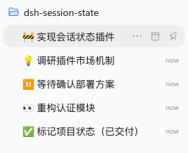
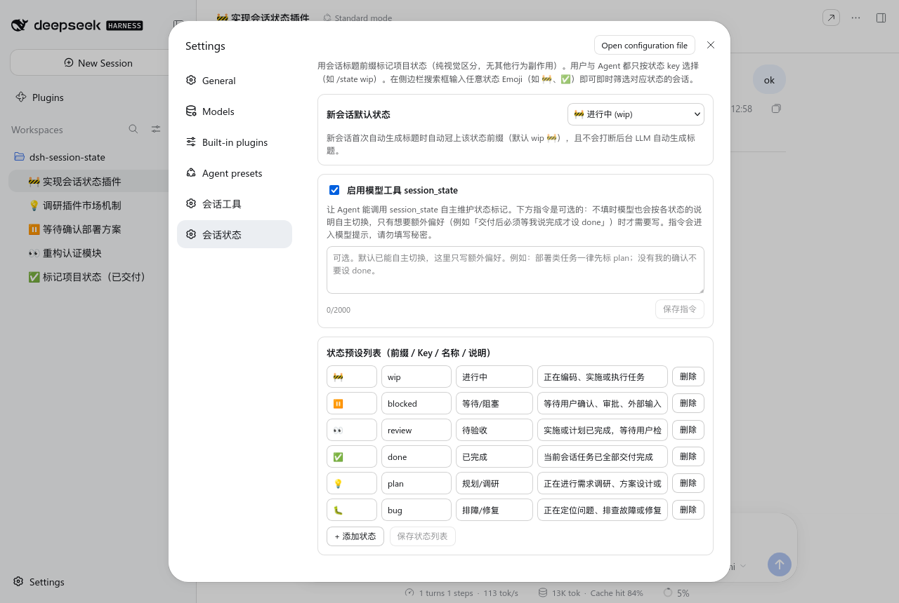

# session-prefix

中文 | [English](README.en.md)

用会话标题前缀（默认 Emoji，可完全自定义）标记 DeepSeek Harness 会话的项目状态——**纯视觉区分，无任何其他行为副作用**。

支持：
- **新会话默认状态**：新会话产生标题时自动冠上默认状态前缀（默认为 `wip` `🚧`，也可在设置页改为其他状态或 `none`），且不会打断后台 LLM 自动生成标题；
- **面向 Agent 的模型工具 `session_prefix`**：让 Agent 在工作流阶段切换时自动更新会话状态前缀；
- **面向用户的斜杠命令 `/state`**：随时查看、切换或清除当前会话的状态前缀；
- **标题跳过规则**：自带行首标签的标题（如 IM 桥接写入的 `Telegram · xxx`）默认不自动加/改前缀，规则可在设置页用正则自定义；
- **Web 插件设置页（「会话状态」）**：可视化增删改状态列表（自定义 Emoji 或文本前缀、Key、名称、说明）、选择新会话默认状态、配置标题跳过规则、开关模型工具并编写自定义 `Operator instructions`；
- **原生侧边栏搜索筛选**：在 DSH 侧边栏搜索框输入任意状态前缀（如 `🚧`、`✅`、`👀`），即可即时筛选出对应状态的所有会话。

## 安装

```bash
dsh plugin --profile web add session-prefix
```

从 GitHub 安装（源码安装，会执行本仓库的 `prepare` 构建）：

```bash
dsh plugin --profile web add github:john-walks-slow/session-prefix
```

本地开发目录直链：

```bash
dsh plugin --profile web add link:/path/to/session-prefix
```

安装后无需手工改配置：插件自带的 `cordis.patch.yml` 自动挂载生效，模型工具表里多出 `session_prefix`，命令表里多出 `/state`，设置页里多出「会话状态」。

> 源码安装需要 Node ≥ 22.5，并在安装时执行构建（`tsc` + `esbuild`，产出 `dist/` 与 `lib/client.js`）。pnpm ≥ 10 需放行该构建（`pnpm approve-builds`，或在 `onlyBuiltDependencies` 中加入本包）。

## 界面





## 权限与兼容

- **状态持久化**：唯一的内部写入是往目标会话日志追加 `session/title` 事件（宿主自己的标题修改事件）。
- **Jev 自动状态推断**：当开启 `jevEnabled`（默认开启）时，插件会在**回合进行中**与**回合结束**两个节点调用 TypeSafe Jev 快决策模型（`typesafe/jev-1.13`，经 OpenRouter Decisions API），自动识别项目所处阶段并更新标题前缀。
  - **回合开始先回落执行态**：宿主又开始驱动某个会话（你追问，或后台任务唤醒它继续跑）时，先把前缀从静止态（⏸️/👀/✅）回落到 `activeState`（默认 `wip`），立刻反映「它已不在等你」；本回合的助手产出与你的新指令会在回合结束/指令落库后再精判。从未打标的会话不会被强行加前缀，`activeState: none` 可关闭该行为。
  - **凭据优先级**：插件设置 `jevApiKey` → 环境变量 `JEV_API_KEY`（端点与模型同理：`jevBaseUrl`/`jevModel` → `JEV_BASE_URL`/`JEV_MODEL`）。若均未配置则静默跳过，绝不报错打断正常会话。
  - **接口与模型**：默认调用 `https://openrouter.ai/api/alpha/decisions`（可通过配置项 `jevBaseUrl` 覆写完整 Decisions API endpoint URL），默认决策模型为 `typesafe/jev-1.13`（可通过 `jevModel` 覆写）。
  - **上下文裁剪**：每次只取你最近一条人类指令（保头部，≤ 800 字符）与助手最近一条产出（保尾部），宿主注入的运行时快照/记忆/时间等消息一律排除，绝不外发全量历史长文本。
  - **平滑协同**：推断更新采用与宿主自动标题对齐的来源标记，绝不打断后台正在运行的 LLM 自动起名 Provider。
- **标题跳过规则（`skipPattern`）**：标题剥离本插件的状态前缀后命中该正则时（默认 `^\S+ · `，即 `Telegram · xxx` 这类自带行首标签的标题），上述所有**自动**行为（新会话默认状态、回合回落、Jev 推断）都不再改写它——标签必须留在行首，被前缀顶开会被对方重新补标签，叠成 `Telegram · 🚧 Telegram · xxx`。用户显式 `/state` 与模型工具调用不受限制；留空即关闭规则。
- **作用范围**：只作用于当前进程内 **live** 的会话（你自己，或 GUI 里打开着的会话）；不会为冷会话拉起 agent，也不会给子代理会话增加前缀。
- 需要提供 `sessionTitle` 服务的 dsh 宿主（`@deepseek-ai/dsh-base` 自带）。宿主没有 `commands` 服务时 `/state` 不注册，其余功能照常。

## 默认状态预设

| Key | 默认前缀 | 名称 | 说明 |
| :--- | :--- | :--- | :--- |
| `wip` | `🚧` | 进行中 | 正在编码、实施或执行任务（新会话默认） |
| `blocked` | `⏸️` | 等待/阻塞 | 等待用户确认、审批、外部输入或遇到阻塞 |
| `review` | `👀` | 待验收 | 实施或计划已完成，等待用户检视或验收 |
| `done` | `✅` | 已完成 | 当前会话任务已全部交付完成 |
| `plan` | `💡` | 规划/调研 | 正在进行需求调研、方案设计或讨论 |
| `bug` | `🐛` | 排障/修复 | 正在定位问题、排查故障或修复缺陷 |
| `clear` / `none` | — | 清除状态 | 剥离已有状态前缀，恢复原始裸标题 |

## 使用方法

### 1. 用户命令 `/state`

```text
/state              # 查看当前会话状态、标题、新会话默认状态及可用状态列表
/state list         # 同上，列出所有可用状态预设
/state wip          # 设为「🚧 进行中」
/state review       # 切换为「👀 待验收」（自动剥离旧前缀，绝不叠加）
/state done         # 切换为「✅ 已完成」
/state none         # 清除状态前缀，恢复原始标题（同 /state clear）
```

状态只用 **key** 选择（如 `wip`、`review`、`done`）；名称与前缀只用于展示，不作为入参。

### 2. 模型工具 `session_prefix`

- `state`（必填）：状态 key（如 `"wip"`、`"review"`、`"done"`），或 `"none"` / `"clear"` 清除状态前缀。
- `session_id`（可选）：目标会话 ID，省略时作用于当前会话（仅限当前进程内的 live 会话）。

**无需任何配置**：工具描述本身就把「按阶段自主维护状态标记」写成明确预期，并给出每个状态的适用场景（取自状态项的「说明」字段）。模型会在开始实施、等待你确认、待验收、完工等阶段自行切换；只有想追加额外偏好（例如「没有我的确认不要设 done」）时才需要在设置页填写指令。

### 3. Web 设置面板

打开 **Settings → 会话状态**：
- 选择**新会话默认状态**（默认 `wip`，可选 `none` 或任意自定义状态）；
- 选择**回合进行中状态**（`activeState`，默认 `wip`；宿主恢复执行某个会话时前缀回落到它，可选 `none` 关闭）；
- 编辑**标题跳过规则**（`skipPattern`，正则，默认 `^\S+ · `；命中规则的标题不再自动加/改前缀，留空关闭）；
- 开关 **Jev 自动状态推断**（在本回合首条人类指令落库后与回合结束自动分析意图与产出，自动更新会话状态前缀）；
- 开关 **`session_prefix` 模型工具**并配置给 Agent 的自定义触发指令（如：`开始实施时设为 wip，等待用户验收时设为 review，完工后设为 done`）；
- **增、删、改**状态预设列表（每项含 key、前缀、名称、说明），或一键恢复默认状态集。所有修改在保存后的下一个回合立即生效。

## 开发与测试

```bash
npm run check   # TypeScript 类型检查
npm run build   # 构建 dist/ 与 lib/client.js
npm test        # 运行构建与全部单元测试
```

## 社区

- 感谢 [LINUX DO](https://linux.do/) 社区提供的交流环境。
